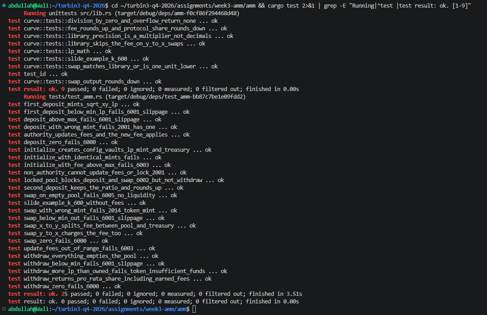

# Turbin3 Week 3: Constant Product AMM (Anchor 1.1.2, LiteSVM)

A constant product AMM (x * y = k) with:
- a swap fee split between liquidity providers and a **treasury**,
- slippage limits on **every** user action,
- my own CPMM math module (`curve.rs`), with no math library in the program,
- an admin who can change fees and pause trading, but can never move pool funds or block withdrawals.

Program ID (localnet): `BVaDvxuTZh9m2jTZjogYTLpiL6SUbSTM1iBsq6NFTRmj`

The design follows the class reference [ShrinathNR/amm_q2_26](https://github.com/ShrinathNR/amm_q2_26), rewritten for Anchor 1.1.2 with `transfer_checked`, a treasury, a fee in both swap directions, and its own math. See [What I changed from the reference](#what-i-changed-from-the-reference-and-why).

**33 tests pass**: 8 math unit tests in `curve.rs` (including comparisons with the `constant-product-curve` crate) and 25 LiteSVM integration tests. Full output: [`test-output.txt`](test-output.txt).



## Run it

```bash
# Rust 1.89.0 (rust-toolchain.toml), Anchor CLI 1.1.2, Solana CLI 3.0.13
anchor build     # builds target/deploy/amm.so
cargo test       # math unit tests + LiteSVM integration tests
```

---

## Architecture

| Account | Address | Owner / authority | Holds |
|---|---|---|---|
| `config` | PDA `["config", seed.to_le_bytes()]` | owned by the AMM program | seed, authority, treasury, mint_x, mint_y, fee_bps, protocol_fee_bps, locked, bumps |
| `mint_lp` | PDA `["lp", config]` | mint authority = `config` PDA | LP token, 6 decimals |
| `vault_x`, `vault_y` | ATA of (`config`, mint) | token authority = `config` PDA | the pool reserves |
| `treasury_x`, `treasury_y` | ATA of (`treasury`, mint) | token authority = the treasury wallet | protocol fees |
| user ATAs | ATA of (user, mint) | the user | user balances, LP tokens |

- The `seed` lets one program host many pools.
- Only the program can move vault tokens or mint LP tokens, because both need a signature from the `config` PDA (`CpiContext::new_with_signer` with `["config", seed, bump]`).
- Token accounts use `token_interface` (`InterfaceAccount`), so the pool works with the Token and the Token-2022 program. Every transfer is `transfer_checked`, which also checks the mint and decimals.

## Instructions

| Instruction | Signer | What it does | Checks |
|---|---|---|---|
| `initialize(seed, fee_bps, protocol_fee_bps)` | authority (admin, payer) | creates config, LP mint, both vaults, both treasury ATAs | `fee_bps <= 1000` (10%), `protocol_fee_bps <= 10000` (6003); mints differ |
| `deposit(lp_amount, max_x, max_y)` | user | adds both tokens, mints LP | not locked (6002); `x <= max_x`, `y <= max_y` (6001); zero (6000); `has_one` mints (2001) |
| `swap(x_to_y, amount_in, min_out)` | user | exact-input swap in either direction, fee split to LPs + treasury | not locked (6002); `out >= min_out` (6001); zero (6000); empty pool (6005); k must not drop (6007); wrong mint (2014, see tests) |
| `withdraw(lp_amount, min_x, min_y)` | user | burns LP, returns the pro-rata share of both reserves | `x >= min_x`, `y >= min_y` (6001); zero (6000). **Not blocked by the lock** |
| `update_fees(fee_bps, protocol_fee_bps)` | authority only | changes the fee settings | `has_one = authority` (2001); ranges (6003) |
| `set_locked(locked)` | authority only | pauses or resumes deposits and swaps | `has_one = authority` (2001) |

## The math (k = x * y)

### Swap

The pool keeps `x * y = k`. Selling `a` of X (after the fee) for Y:

```
out = floor( y * a / (x + a) )
```

This is the same as `y - k / (x + a)`, but rounded down so the pool never pays out a fraction it does not have.

**Worked example (the slides, no fee):** x = 20, y = 30, so k = 600.
- Swap 5 X: out = 30 * 5 / (20 + 5) = 150 / 25 = **6 Y**. New pool: 25 X, 24 Y, k = 600.
- Swap 5 X again: out = 24 * 5 / (25 + 5) = 120 / 30 = **4 Y**. New pool: 30 X, 20 Y, k = 600.

The second swap of the same size gives less, because the price moved: that is price impact. The test `slide_example_k_600_without_fees` runs exactly this on-chain.

### LP tokens

- **First deposit:** `lp = floor(sqrt(x * y))`. The geometric mean makes the LP amount independent of the starting price. Example: 1,000 X and 4,000 Y give sqrt(4,000,000) = **2,000 LP**.
- **Later deposits:** to mint `lp`, pay `ceil(lp * X / L)` and `ceil(lp * Y / L)` (L = LP supply). Example: pool 1,000 X / 4,000 Y / 2,000 LP; 200 LP (10%) costs 100 X + 400 Y.
- **Withdraw:** burning `lp` returns `floor(lp * X / L)` and `floor(lp * Y / L)`.

### Rounding: always in the pool's favour

| Amount | Direction | Why |
|---|---|---|
| swap output | down | the pool never pays a fraction more |
| fee | up | the pool never charges a fraction less |
| deposit amounts | up | a depositor never gets LP for free |
| withdraw amounts | down | a withdrawer never takes more than their share |

All intermediate products are u128 (`checked_*`), so `u64 * u64` cannot overflow. After every swap the program also checks `k_after >= k_before` (6007) as a safety net.

## Fees and treasury (task 2)

Two numbers in `config`:
- `fee_bps`: total swap fee, in basis points of the input (30 bps = 0.30%).
- `protocol_fee_bps`: the treasury's share **of the fee**, in basis points (2000 = 20% of the fee).

For an input `amount_in`:

```
fee          = ceil(amount_in * fee_bps / 10_000)          (rounded up)
protocol_fee = floor(fee * protocol_fee_bps / 10_000)      (rounded down)
lp_fee       = fee - protocol_fee                          (stays in the vault)
out          = floor(y * (amount_in - fee) / (x + amount_in - fee))
```

The user sends `amount_in - protocol_fee` to the vault and `protocol_fee` to the treasury ATA of the input token. The LP part of the fee stays in the vault but is not used for pricing, so k grows with every swap and LPs earn it when they withdraw.

**Worked example (from the tests):** pool 1,000 X / 4,000 Y, fee 30 bps, protocol 20%, swap 10 X:
- fee = 0.03 X, protocol_fee = 0.006 X to the treasury, lp_fee = 0.024 X stays in the pool
- out = 4,000 * 9.97 / 1,009.97 = **39.486321 Y** (rounded down to 6 decimals)
- vault X = 1,000 + 10 - 0.006 = 1,009.994 X; k went up

Only the authority may change the fee settings (`update_fees`, `has_one = authority`).

## Slippage protection

| Action | Limit | Error |
|---|---|---|
| swap | `min_out`: least output accepted | 6001 SlippageExceeded |
| deposit | `max_x`, `max_y`: most the user pays; first deposit: `lp_amount` is the minimum LP | 6001 |
| withdraw | `min_x`, `min_y`: least the user receives | 6001 |

The price can move between the moment a user signs and the moment the transaction lands (other swaps, or a sandwich attack). These limits make the transaction fail instead of executing at a worse price.

## Admin and the lock

- The authority can lock the pool: deposits and swaps fail with 6002.
- **Withdrawals stay open while locked**, so LPs can always take their funds out. The reference AMM blocks withdrawals when locked, which would trap LP funds.
- The admin has no instruction that moves vault tokens.

## What I changed from the reference, and why

| Reference | Mine | Why |
|---|---|---|
| `transfer` | `transfer_checked` | checks mint and decimals; required for Token-2022 mints with extensions |
| `Account<Mint>` / `Program<Token>` | `InterfaceAccount` / `Interface<TokenInterface>` | works with Token and Token-2022 |
| no treasury | treasury ATAs + `protocol_fee_bps` | task 2 |
| first deposit: user chooses the LP amount | `sqrt(x * y)` | the first depositor cannot pick an arbitrary LP supply |
| lock blocks withdraw | lock blocks only deposit and swap | LPs can always exit |
| `constant-product-curve` crate | own `curve.rs` | task 4; also avoids two problems found in the crate (below) |

### Two problems found in `constant-product-curve` (rev `2a723a0`)

Both are proven by unit tests in `curve.rs`:

1. **`precision` is a raw multiplier, not "decimals".** The reference passes `6` as if it meant 6 decimals. The crate computes a ratio scaled by that number, so with 6 the ratio only has steps of 1/6. Pool 1,000 X / 2,000 Y / 1,000 LP, burn 100 LP (10%): the crate returns **167 X and 334 Y** (16.7%). Mint 100 LP: it asks for **0 X and 0 Y**. With `precision = 1_000_000` it agrees with my math. Test: `library_precision_is_a_multiplier_not_decimals`.
2. **No fee on Y to X swaps.** In `swap()` the Y branch uses the raw amount `a` instead of the amount after fee `a2`, so swapping Y for X pays no fee. Test: `library_skips_the_fee_on_y_to_x_swaps`. My `swap` charges the fee in both directions (test: `swap_y_to_x_charges_the_fee_too`).

The crate also rounds swap output **up** (`y - floor(k / (x + a))`). My output is equal or exactly 1 unit lower, never higher. Test: `swap_matches_library_or_is_one_unit_lower`.

## Tests

Every failure test asserts the exact error number.

| Area | Tests |
|---|---|
| Math (`curve.rs`, 8) | slide example k = 600; swap output rounds down; fee rounds up and protocol share rounds down; LP math (sqrt, ceil deposit, floor withdraw); division by zero and overflow return None; ours equals the crate or is 1 unit lower; crate skips the fee on Y to X; crate's `precision` is a multiplier |
| initialize (3) | creates config, vaults, LP mint (authority = config PDA), treasury ATAs; fee above max (6003); identical mints fail |
| deposit (6) | first deposit mints sqrt(x*y); second deposit keeps the ratio; above max_x / max_y (6001); first deposit below min LP (6001); zero (6000); wrong mint (2001 `has_one`) |
| swap (8) | slide example 20/30 then 25/24 on-chain; X to Y fee split between pool and treasury with exact numbers; Y to X charges the fee too; below min_out (6001); zero (6000); wrong mint (2014); empty pool (6005) |
| withdraw (5) | pro-rata share including earned fees; withdraw everything empties the pool; below min_x / min_y (6001); more LP than owned (Token error 1); zero (6000) |
| admin (4) | authority updates fees and the new fee applies; non-authority update_fees / set_locked (2001); fee out of range (6003); lock blocks deposit and swap (6002) but not withdraw, unlock resumes trading |

Two constraint-order facts showed up in these tests:
- A fake `mint_x` in **swap** fails with **2014 ConstraintTokenMint**, not 2001: `user_x` is `init_if_needed`, and Anchor validates an `init_if_needed` account's mint while loading it, before `has_one` runs.
- The same fake mint in **deposit** fails with **2001 ConstraintHasOne**, because no account before `config` checks the mint there.

## Mitigating downtime in DeFi applications (task 5)

"Downtime" for an AMM can come from the chain, from the program, or from the services around it. Ways to reduce the damage:

1. **Chain halts or heavy congestion.** Solana has halted before. Users cannot act during a halt, and when it restarts prices can jump. Every user action already carries a slippage limit, so a transaction that lands late at a bad price fails instead of executing. A next step is a `deadline` (unix timestamp) argument on swaps, so a transaction signed before a halt cannot execute long after it.
2. **Landing transactions under load.** Clients should set a priority fee from recent fee data, use durable nonces or retries with fresh blockhashes, and fall back across several RPC providers. Most "the DEX is down" moments are really "the RPC is down".
3. **Pausing safely.** The `lock` stops new deposits and swaps if a bug or attack is found, but never traps funds: withdrawals stay open. The lock authority should be a multisig (for example Squads) so one leaked key cannot pause or reconfigure the pool, and fee changes could go through a timelock.
4. **No external dependencies in the core path.** The pool prices from its own reserves, not from an oracle, so an oracle outage cannot stop swaps or cause bad liquidations. Anything built on top that uses the pool as a price source should use a time-weighted price, not the spot price, so a halt-and-restart price spike cannot be exploited.
5. **Upgrades and incidents.** Keep the upgrade authority on a multisig, test upgrades on devnet and with LiteSVM first, and monitor the program's logs and vault balances so an incident is noticed in minutes. An immutable core with withdrawals always open means that, in the worst case, users can still leave.

## Security notes

- No keypair is committed (`target/`, which holds the program keypair, is gitignored).
- Known limits: no minimum-liquidity lock on the first deposit (Uniswap v2 burns 1,000 LP units to stop share-price inflation attacks), no swap deadline yet, and the fee math assumes both mints have no transfer-fee extension.
- Not audited; localnet tests only.
